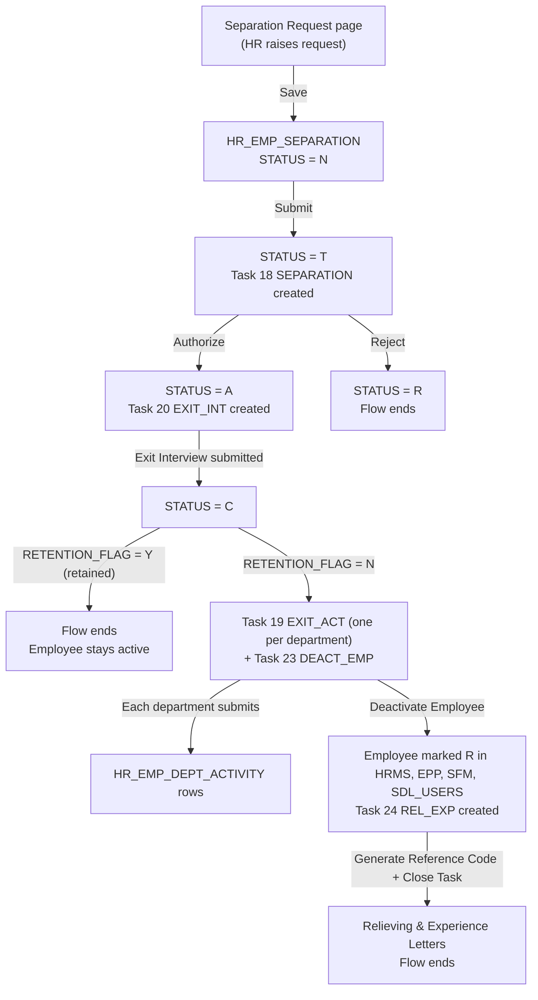

# HRMS Separation (Exit) Workflow

How an employee's exit moves through HRMS, from the Separation Request to the Relieving & Experience Letters: which task is created at each step, who can see it, which tables are written, and what each status and flag means.

Last checked against the code and the database (HRMSLIVE) on 05-Nov-2026.

## 1. Overview

| Step | Task ID | Task group (`HR_TASK_MASTER.TASK_GRP`) | Screen | Created when | Assigned to (`HR_USER_TASKS`) |
|---|---|---|---|---|---|
| 1. Separation Request | 18 | `SEPARATION` | Separation Request page, then Exit Authorization → Separation Request modal | Request is **submitted** | Unassigned; company / division / department of the employee |
| 2. Exit Interview | 20 | `EXIT_INT` | Exit Interview modal | Separation is **authorized** | Unassigned; employee's company / division, department 35 (Human Resource) |
| 3. Exit Activity | 19 | `EXIT_ACT` | Exit Activity modal | Exit Interview **submitted** with `RETENTION_FLAG = N` | Unassigned; one task per clearing department |
| 4. Deactivate Employee | 23 | `DEACT_EMP` | Deactivate Employee modal | Exit Interview **submitted** with `RETENTION_FLAG = N` (same time as step 3) | Unassigned; department 35 (Human Resource) |
| 5. Relieving & Experience Letter | 24 | `REL_EXP` | Relieving & Experience Letter modal | Employee **deactivated** | Unassigned; department 35 (Human Resource) |

Common rules for every task:

- **`TRAN_CODE`:** always `HR_EMP_SEPARATION.ID`, which links all five tasks to one separation.
- **`EMP_CODE_FOR`:** always empty, so no task is assigned to a named person. A user sees a task when their profile has that task ID (`HR_PROFILE_TASK`) and their profile scope covers the task's company, division and department (`HR_PROFILE_COMPANY`, `HR_PROFILE_DIVISIONS`, `HR_PROFILE_DEPARTMENT`). This is the same as the legacy `separation_sv.php`.
- **Status on creation:** `O` (Open). Completing a step sets the task to `C` (Closed) with `AUTH_BY`, `AUTH_ON` and `REMARKS`.
- **Transactions:** each action runs in one transaction. If any write fails, nothing from that action is saved and no task is created or closed.

> **Who authorizes the Separation Request.** The request does not go to a named HOD. Task 18 goes to every user whose profile includes task 18 and covers the employee's company, division and department. The organogram is used only to pre-fill **Handover To** with the reporting manager (`findParentOrgEmp`: the employee at the parent position in `HR_ORG_LOC_PARENT`). To route it to the HOD personally, task 18 would need `EMP_CODE_FOR` set to that person, which neither the legacy code nor the new code does today.

Profiles that currently have each task (`HR_PROFILE_TASK`, active rows):

| Task | Profiles |
|---|---|
| 18 Separation Request | ADMIN, HR ADMIN, HR USER SDL, MANAGER SHL, MANAGER VI, MANAGER VR, MANAGER VS, MANAGER VT, SDL PAYROLL USER |
| 19 Exit Activity | ADMIN, HR ADMIN, HR USER, HR USER SDL, SECRETARY SHL, SECRETARY VR, SECRETARY VS, SECRETARY VT |
| 20 Exit Interview | ADMIN, HR ADMIN, HR USER, HR USER SDL |
| 23 Deactivate Employee | ADMIN, HR ADMIN, HR USER, HR USER SDL, SDL PAYROLL USER |
| 24 Rel & Exp Letter | ADMIN, HR ADMIN, HR USER, HR USER SDL, SDL PAYROLL USER |

Task 19 has one extra rule (`HRMS_DEPARTMENT_TASK_IDS` in `config/hrmsAccess.php`): employees of the task's own department, in the same company, also see it without a profile.

## 2. Codes and flags

### `HR_EMP_SEPARATION.STATUS`

| Code | Label on screen | Meaning | Set by |
|---|---|---|---|
| `N` | Not Sent for Auth | Request saved as a draft; can still be edited | Separation Request → Save |
| `T` | In Progress | Submitted, waiting for authorization (task 18 open) | Separation Request → Submit |
| `A` | Approved | Authorized; Exit Interview pending (task 20 open) | Task 18 → Authorize |
| `R` | Rejected | Request rejected; flow ends | Task 18 → Reject |
| `C` | Closed | Exit Interview submitted | Task 20 → Submit |

`C` is set when the Exit Interview is submitted, for **both** outcomes. A retained employee (`RETENTION_FLAG = Y`) and a leaving employee (`RETENTION_FLAG = N`) are both `C`, even though the leaving employee still has Exit Activity, Deactivate and Letter tasks to go. To know whether someone actually left, check `RETENTION_FLAG = 'N'` and `HR_EMPLOYEE_INFO.STATUS = 'R'`.

### Other codes

| Column | Code | Meaning |
|---|---|---|
| `HR_EMP_SEPARATION.RESIGN_TYPE` | `R` | Resignation |
| | `T` | Termination |
| | `A` | Absconding |
| | `W` | Retired |
| | `C` | Contract Discontinued |
| `HR_EMP_SEPARATION.RESIGN_MODE` | `E` | Email (recipient email required) |
| | `T` | Telephonic |
| | `O` | Other |
| `HR_EMP_SEPARATION.RETENTION_FLAG` | `Y` | Employee retained; flow ends after the Exit Interview |
| | `N` | Not retained; Exit Activity and Deactivate tasks are created |
| `HR_EMP_DEPT_ACTIVITY.STATUS` | `Y` | Yes, activity done |
| | `N` | No (does not block Submit) |
| | `X` | Not Applicable |
| `HR_USER_TASKS.STATUS` | `O` | Open |
| | `C` | Closed |
| `HR_DEPT_JOEX_ACTIVITY.ACT_TYPE` | `E` | Exit activity (only `E` rows are used here) |
| `HR_JD_QUESTIONS.QGRP_TYPE` | `X` | Exit interview question group |
| `HR_QUESTION_MASTER.RATING_TYPE` | `R` | Single choice (radio) |
| | `C` | Multiple choice (checkbox); answers stored comma-separated |
| | other | Free text (up to 1000 characters) |
| `HR_EMP_DOCS.DOC_ID` | `3` | Relieving Letter |
| | `4` | Experience Letter |
| `HR_BCS_OUTWARD_REF.OUTWARD_TYPE` | `LTTR` | Outward letter |
| Relieving letter `flag` (URL parameter) | `H` | Head Office template |
| | `F` | Field template |

## 3. Step 1: Separation Request (task 18)

**Who raises it:** an HR user, from **Separation → Separation Request** (`/hrms/separation`).

**Employee list.** The dropdown shows only active employees (`HR_EMPLOYEE_INFO.STATUS = 'A'`) whose current office record falls in the user's profile scope. Anyone who already has a separation that is not Rejected (status `N`, `T`, `A` or `C`) is hidden. A Rejected request does not block a new one. An exit completed before the employee's current office began does not block one either, as that means they have been rehired since.

**Validations:**

- **Required fields:** employee, resignation type, resignation mode, resignation date, expected relieving date and employee comments (up to 2000 characters).
- **Recipient email:** required and must be a valid email when the mode is `E` (Email); up to 50 characters. For other modes it is stored empty.
- **Dates:** the expected relieving date cannot be before the resignation date.
- **One request per employee:** only one separation that is not Rejected is allowed per employee.

**Save** (`STATUS = N`):

| Table | Action | Columns |
|---|---|---|
| `HR_EMP_SEPARATION` | INSERT (new) or UPDATE (only while `STATUS = 'N'`) | `EMP_CODE`, `RESIGN_TYPE`, `RESIGN_MODE`, `RESIGN_RCP_EMAIL`, `RESIGN_RCP_DATE`, `EXP_RELIV_DATE`, `EMP_COMMENTS`, `ENTER_BY_EMP` = user, `ENTER_ON_EMP` = SYSDATE, `STATUS = 'N'`, `HANDOVER_TO` = reporting manager from the organogram |

**Submit** (`STATUS = T`): saves as above, then:

| Table | Action | Columns |
|---|---|---|
| `HR_EMP_SEPARATION` | UPDATE | `STATUS = 'T'` |
| `HR_USER_TASKS` | INSERT task 18 | `TRAN_CODE` = separation ID, `TRAN_DESC` = "Resignation Request of &lt;employee&gt;", `STATUS = 'O'`, `COMP_ID` = employee's company, `DIVSN_ID` / `DEPT_ID` = employee's office on the expected relieving date |

**List order:** latest entry first (`ENTER_ON_EMP DESC`).

### Authorization (Exit Authorization → Separation Request)

The authorizer can change **Handover To** (must be an active employee) and must enter the **Approved Relieve Date** and **Authorize Comments** (up to 500 characters). The task must still be open and the separation must be `T`.

**Authorize:**

| Table | Action | Columns |
|---|---|---|
| `HR_EMP_SEPARATION` | UPDATE | `STATUS = 'A'`, `RELEIVING_DATE` = approved relieve date, `AUTH_BY_EMP`, `AUTH_COMMENTS`, `HANDOVER_TO` |
| `HR_USER_TASKS` | INSERT task 20 | `TRAN_DESC` = "Exit Interview For &lt;employee&gt; - &lt;date&gt;", company and division from the employee's organogram on the expected relieving date, `DEPT_ID = 35` |
| `HR_USER_TASKS` | UPDATE task 18 | `STATUS = 'C'`, `REMARKS` = authorize comments |

**Reject:**

| Table | Action | Columns |
|---|---|---|
| `HR_EMP_SEPARATION` | UPDATE | `STATUS = 'R'`, `AUTH_BY_EMP`, `AUTH_COMMENTS` |
| `HR_USER_TASKS` | UPDATE task 18 | `STATUS = 'C'` |

## 4. Step 2: Exit Interview (task 20)

**Questions:** taken from the employee's Job Description: `HR_JD_QUESTIONS` with `QGRP_TYPE = 'X'`, joined to `HR_QUESTION_MASTER` and grouped by `HR_QUESTION_SGROUP`. Options come from `HR_QUESTION_OPTS`. The JD is the one on the employee's organogram position (`HR_ORGANOGRAM.JD_ID`) as on the relieving date. If the JD has no exit questions, the interview cannot be saved.

**Inputs:**

- **Answers:** one per question; text answers are up to 1000 characters.
- **Retain employee?:** Y or N, required.
- **Exit / Retention Comments:** required, up to 500 characters.

**Validation:** Save accepts partial answers. Submit requires every question to be answered. Radio and checkbox answers must be one of the configured options.

**Save:**

| Table | Action | Columns |
|---|---|---|
| `HR_EMP_EXIT_INTRV` | DELETE all rows for the separation, then INSERT one row per answered question | `REF_ID` = separation ID, `EMP_CODE`, `HR_EMP_CODE` = interviewer, `JD_ID`, `QUES_ID`, `EMP_ANS_TEXT`, `ASON_DATE`, `CHG_BY`, `CHG_ON` |
| `HR_EMP_SEPARATION` | UPDATE | `EXIT_COMMENTS`, `RETENTION_FLAG`, `EXIT_COMMENT_BY`, `EXIT_COMMENT_ON` |

**Submit:** the same writes, plus:

| Table | Action | When | Columns |
|---|---|---|---|
| `HR_EMP_SEPARATION` | UPDATE | Always | `STATUS = 'C'` |
| `HR_USER_TASKS` | INSERT task 19, one per department | `RETENTION_FLAG = N` | `DEPT_ID` = each department in `HR_JD_REF_DEPT` for the employee's JD that has at least one `ACT_TYPE = 'E'` activity in `HR_DEPT_JOEX_ACTIVITY`; `TRAN_DESC` = "Exit activity for &lt;employee&gt;" |
| `HR_USER_TASKS` | INSERT task 23 | `RETENTION_FLAG = N` | `DEPT_ID = 35`; `TRAN_DESC` = "Deactive User : &lt;employee&gt; - &lt;relieving date&gt;" |
| `HR_USER_TASKS` | UPDATE task 20 | Always | `STATUS = 'C'` |

With `RETENTION_FLAG = Y` no further tasks are created and the employee stays active.

**Configuration needed for Exit Activity tasks.** Exit Activity tasks are created only for departments mapped to the employee's JD in **JD → Department Reference** (`HR_JD_REF_DEPT`) that also have exit activities in **Department Activity** (`HR_DEPT_JOEX_ACTIVITY`, type E). If the JD has no such mapping, only the Deactivate task is created.

## 5. Step 3: Exit Activity (task 19)

Each clearing department gets its own task. The modal lists that department's exit activities (`HR_DEPT_JOEX_ACTIVITY` with `ACT_TYPE = 'E'`, ordered by `DISP_SEQ`) with the values saved earlier.

**Inputs:** for every activity, a Status (`Y` Yes, `N` No, `X` Not Applicable) and Remarks (required, up to 200 characters).

**Buttons:**

- **Save:** stores the values and keeps the task open.
- **Submit:** enabled only after a save. Allowed whatever the answers are (`Y`, `N` or `X`).

**Writes:**

| Table | Action | When | Columns |
|---|---|---|---|
| `HR_EMP_DEPT_ACTIVITY` | DELETE then INSERT one row per activity | Save and Submit | `REF_ID` = separation ID, `EMP_CODE`, `DEPT_ACT_ID`, `DEPT_ID`, `DISP_SEQ`, `ACT_TYPE = 'E'`, `ACT_DESC`, `STATUS`, `REMARKS`, `ASON_DATE`, `CHG_BY`, `CHG_ON` |
| `HR_USER_TASKS` | UPDATE task 19 | Submit | `STATUS = 'C'` |

The Deactivate Employee modal shows each department's clearance as **Open** (task 19 still `O`) or **Closed**, with who closed it (`HR_USER_TASKS.AUTH_BY`). **Closed** means the department submitted. If it submitted any activity as `N`, the status reads **Closed (n No)** in red, with those activities listed under it.

## 6. Step 4: Deactivate Employee (task 23)

**Inputs:** Resignation Type, Resignation Mode and Handover To can be corrected on this screen. The Approved Relieve Date is read-only, and the separation must have one.

**Open clearances:** deactivation is allowed even while some department clearances are still Open. The confirmation message shows how many are open, but they do not block it.

**One transaction** (the relieve date below is `HR_EMP_SEPARATION.RELEIVING_DATE`):

| System | Table | Update |
|---|---|---|
| HRMS | `HR_EMP_SEPARATION` | `RESIGN_TYPE`, `RESIGN_MODE`, `HANDOVER_TO` |
| HRMS | `HR_EMPLOYEE_INFO` | `STATUS = 'R'`, `DOL` = relieve date |
| HRMS | `HR_EMP_OFFICE_DET` (current row) | `EFFEC_TO` = relieve date |
| HRMS | `HR_ORGANOGRAM` (employee's position) | `FILL_COUNT = FILL_COUNT - 1` |
| HRMS | `HR_EMP_TENURE` (current row) | `EFF_TO` = relieve date |
| EPP | `HR_BCS_USERS` → `EPPLIVE.BCS_USERS` | `STATUS = 'R'`, `VALID_UPTO` = relieve date |
| EPP | `HR_BCS_EMPLOYEE` → `EPPLIVE.BCS_EMPLOYEE` | `STATUS = 'R'`, `RELIEVE_DATE` = relieve date (EPP payroll uses this to stop and prorate salary) |
| Login | `SDLUSERS.SDL_USERS` | `STATUS = 'R'` (the login only accepts `A`), `VALID_UPTO` = relieve date |
| SFM | `HR_SFM_EMP_GEO` → `TEAMSDL` | Current territory rows: `EFFEC_TO` = relieve date |
| SFM | `HR_SFM_EMP_DIVISIONS` → `TEAMSDL` | Current division rows: `EFFEC_TO` = relieve date |
| SFM | `HR_SFM_EMPLOYEE_INFO` → `TEAMSDL` | `STATUS = 'R'`, `DOL` = relieve date |
| Tasks | `HR_USER_TASKS` | INSERT task 24 (`DEPT_ID = 35`, "Releiving & Exp Letter : &lt;employee&gt; - &lt;relieving date&gt;"); UPDATE task 23 to `C` |

Every system above sits in the same Oracle database (`ora19csdl`), so these updates commit or roll back together.

## 7. Step 5: Relieving & Experience Letter (task 24)

The modal previews both letters. The Relieving Letter has two templates: Head Office (`flag=H`) and Field (`flag=F`). The PDFs are generated by `api/hrms/reports/pdfReport/relieving_letter.php` and `experience_letter.php`.

**Generate Reference Code.** For each letter that does not have a reference yet for this separation, the system issues a reference number and records it:

| Table | Action | Columns |
|---|---|---|
| `HR_BCS_OUTWARD_REF` | INSERT | `OUTWARD_TYPE = 'LTTR'`, `DOC_REF`, `OUTWARD_DATE`, `DEPT_CODE` and `SITE_CODE` (from the user's EPP record), `OUTWARD_FROM` = user, `OUTWARD_TO` = employee, `PLACE` = employee city, `REMARKS` = "RELIEVING - &lt;name&gt;" / "EXPERIENCE LETTER - &lt;name&gt;" |
| `HR_EMP_DOCS` | INSERT | `EMP_CODE`, `EMP_ID`, `DOC_ID` (3 or 4), `DOC_REF`, `DOC_PATH = input/emp_docs/Relieving_Letter_<id>.pdf` or `Experience_Letter_<id>.pdf` |

**Reference format:** `MMYY/<work site>/<department short code>/LTTR/<sequence>`.

- **Work site:** the user's `WORK_SITE` in EPP (`HR_BCS_EMPLOYEE`).
- **Department short code:** the employee's department (`HR_DEPARTMENT.SHORT_CODE`).
- **Sequence:** `EPPLIVE.TRAN_OR_<work site>_<prefix>_SEQ`. The prefix is the `DOC_PREFIX` of the current accounting period: `HR_BCS_PERIOD`, then `HR_BCS_ACCT_PERIOD`.
- **If it fails:** a missing period row or sequence stops reference generation with an error.

**Which letters count for this separation:** only `HR_EMP_DOCS` rows created on or after the separation was raised, so letters from an earlier employment are ignored.

**Close Task:** allowed only after both letters have a reference. Sets task 24 to `C` with remarks "RELIEVING AND EXPERIENCE LETTER PRINTED & CLOSED". The exit is then complete.

## 8. Where the code lives

| Part | Location |
|---|---|
| Separation Request page | `src/portals/hrms/pages/separation/SeparationRequest.jsx` |
| Task modals | `src/portals/hrms/pages/separation/` (`ExitSeparationRequestModal`, `ExitInterviewModal`, `ExitActivityModal`, `ExitDeactivateEmployeeModal`, `ExitLetterModal`, `ExitModalShell`, `exitOptions.js`) |
| Exit task lists (`/hrms/taskauthorization/E/:tid`) | `src/portals/hrms/authorization/exit/` |
| Frontend API calls | `src/portals/hrms/services/exitService.js`, endpoints under `EXIT` in `src/portals/hrms/config/hrmsApiConfig.js` |
| Separation Request APIs | `sdlhub-backend/api/hrms/separation/` (`getSeparationRequests.php`, `saveSeparationRequest.php`) |
| Task APIs | `sdlhub-backend/api/hrms/authorization/exit/` (`getExitTaskDetails.php`, `saveExitSeparation.php`, `saveExitInterview.php`, `saveExitActivity.php`, `deactivateExitEmployee.php`, `generateExitLetterReference.php`, `closeExitLetterTask.php`) |
| Shared exit helpers and constants | `sdlhub-backend/api/hrms/authorization/exit/exitCommon.php` |
| Letter PDFs | `sdlhub-backend/api/hrms/reports/pdfReport/` (`relieving_letter.php`, `experience_letter.php`, `exit_letter_common.php`) |
| Task visibility rules | `sdlhub-backend/api/config/hrmsAccess.php` |

The behaviour was ported from the legacy `separation_sv.php`, `separation_edit.php`, `separation_auth.php`, `exit_int.php`, `exit_act.php`, `exit_act_sv.php`, `relieving_letter.php` and `experience_letter.php`. One thing is new compared with the legacy code: deactivation also sets the employee's central login (`SDLUSERS.SDL_USERS`) to `R`.
