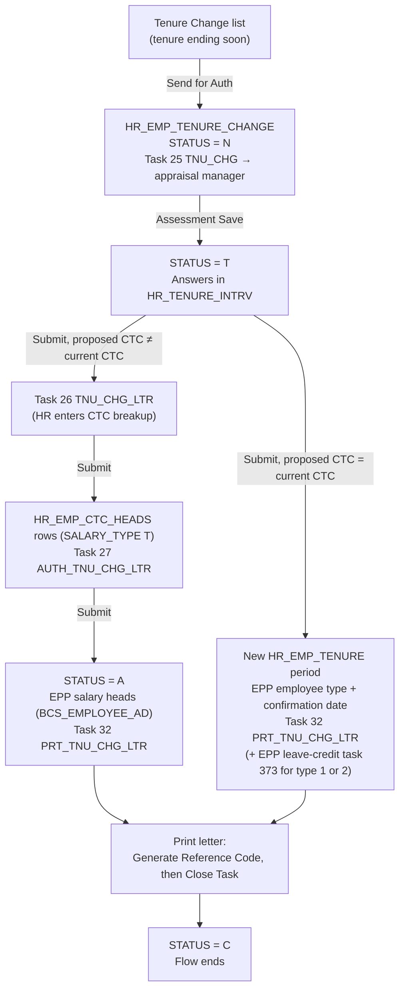

# HRMS Tenure Change Workflow

How a tenure change (confirmation, or an extension of a trainee, contract or probation period) moves through HRMS, from the Tenure Change list to the printed letter: which task is created at each step, who can see it, which tables are written, and what each status and flag means.

Last checked against the code and the database (HRMSLIVE, EPPLIVE) on 05-Nov-2026. Section 9 lists known issues found while writing this document.

## 1. Overview

| Step | Task ID | Task group (`HR_TASK_MASTER.TASK_GRP`) | Screen | Created when | Assigned to (`HR_USER_TASKS`) |
|---|---|---|---|---|---|
| 1. Tenure Change (assessment) | 25 | `TNU_CHG` | Tenure Change list → Send for Auth; then Tenure Change Assessment modal | HR clicks **Send for Auth** | **Assigned** to the appraisal manager (`EMP_CODE_FOR`) |
| 2. CTC Change | 26 | `TNU_CHG_LTR` | Tenure CTC modal | Assessment submitted with a changed CTC | Unassigned; employee's company / division / department |
| 3. CTC Approval | 27 | `AUTH_TNU_CHG_LTR` | Tenure CTC modal (final) | CTC Change submitted | Unassigned; same company / division / department as task 26 |
| 4. Print Tenure Change Letter | 32 | `PRT_TNU_CHG_LTR` | Tenure Change Letter modal | CTC Approval submitted, or assessment submitted with an unchanged CTC | Unassigned; employee's company / division / department |

Common rules:

- **`TRAN_CODE`:** the **employee code**, not the tenure change ID (unlike the Exit workflow). The tenure change record is found through `HR_EMP_TENURE_CHANGE.EMP_CODE` and its status.
- **Task visibility:**
  - Task 25 is assigned to the appraisal manager in `EMP_CODE_FOR`, so only that person sees it.
  - Tasks 26, 27 and 32 have no assignee. A user sees one when their profile has that task ID (`HR_PROFILE_TASK`) and their profile scope covers the task's company, division and department.
- **Task status:** `O` (Open) on creation. Completing a step sets the task to `C` (Closed) with `AUTH_BY` and `AUTH_ON`.

Profiles that currently have each task (`HR_PROFILE_TASK`, active rows). Task 25 is assigned to a person, so its profile list does not decide who acts on it.

| Task | Profiles |
|---|---|
| 25 Tenure Change | ADMIN, MANAGER ACCOUNTS, MANAGER HCS, MANAGER OPL, MANAGER QA QC, MANAGER SDARF, MANAGER SDL, MANAGER SHL, MANAGER VI, MANAGER VR, MANAGER VS, MANAGER VT |
| 26 CTC Change | ADMIN, HR ADMIN, HR USER |
| 27 CTC Approval | ADMIN, HR ADMIN |
| 32 Print Tenure Change Ltr. | ADMIN, HR USER, HR USER SHL, SDL PAYROLL USER, SECRETARY SHL, SECRETARY VR, SECRETARY VS, SECRETARY VT |

## 2. Codes and flags

### `HR_EMP_TENURE_CHANGE.STATUS`

| Code | Meaning | Set by |
|---|---|---|
| `N` | Tenure change raised; task 25 waiting for the manager's assessment | Send for Auth |
| `T` | Assessment saved; in progress through CTC Change / CTC Approval / letter | Assessment Save |
| `A` | CTC approved (final authorization done); letter pending | Task 27 Submit |
| `C` | Letter reference generated and print task closed; flow ends | Task 32 Close Task |

When the CTC does not change, the record stays `T` until the letter task is closed. It never becomes `A`.

### Employee types (`HR_EMP_TYPE.ETYPE_ID`)

| ID | Type | Letter template (`api/hrms/reports/pdfReport/`) | Letter document (`HR_DOC_TYPES`) |
|---|---|---|---|
| 1 | Permanent | `confirmation_letter_revised.php` | 14 Confirmation Letter |
| 2 | Contractual | `extension_letter_contract.php` | 16 Extension Letter |
| 4 | Temporary | `probation_letter.php` | 16 Extension Letter |
| 5 | Probationary | `extension_letter_probation.php` | 16 Extension Letter |
| 6 | Trainee | `extension_letter_trainee.php` | 16 Extension Letter |

The type on the letter is the **new** type chosen in the assessment (`HR_EMP_TENURE_CHANGE.ETYPE_ID`). Choosing Permanent (1) makes it a confirmation; any other type makes it an extension, with the period in months (`ETYPE_PERIOD`).

### Other codes

| Column | Code | Meaning |
|---|---|---|
| `HR_USER_TASKS.STATUS` | `O` | Open |
| | `C` | Closed |
| `HR_JD_QUESTIONS.QGRP_TYPE` | `T` | Tenure assessment question group |
| `HR_QUESTION_MASTER.RATING_TYPE` | `R` | Single choice (radio) |
| | `C` | Multiple choice (checkbox); answers stored comma-separated |
| | other | Free text (up to 1000 bytes) |
| `HR_EMP_CTC_HEADS.SALARY_TYPE` | `T` | Tenure CTC row (`REF_ID` = tenure change ID) |
| `HR_EMP_CTC_HEADS.STATUS` | `T` | Written by the CTC Change / CTC Approval steps |
| `HR_EMP_CTC_HEADS.CALC_TYPE` | `F` | Allowance head (`HR_BCS_ALLW_DEDN.AD_TYPE = 'A'`) |
| | `P` | Deduction head (`AD_TYPE = 'D'`) |
| `AD_CODE = 'XPFBS'` (amount column) | `0` | PF at 12% of basic |
| | `1` | PF on a fixed basis of 15,000 |
| `EPPLIVE.BCS_EMPLOYEE_AD.TYPE` | `F` | Fixed amount |
| | `P` | Percentage |
| `EPPLIVE.BCS_EMPLOYEE_AD.CONFIRMED` | `Y` | Approved salary head |
| `HR_JD_CTC_HEADS.KEY` (CTC structure) | `C` | % of monthly CTC |
| | `B` | % of basic |
| | `F` | Fixed amount |
| `HR_BCS_OUTWARD_REF.OUTWARD_TYPE` | `LTTR` | Outward letter |

## 3. Step 0: Tenure Change list (who is due)

**Screen:** Maintenance → Tenure Change (`/hrms/maintainance/tenure-change`). API: `getTenureChangeList.php`.

**Who appears.** Employees whose latest tenure (`HR_EMP_TENURE`, latest `EFF_TO`) meets all of these:

- **Employee type:** Contractual (2), Probationary (5) or Trainee (6).
- **Status:** active (`HR_EMPLOYEE_INFO.STATUS = 'A'`).
- **Company:** in the user's company access.
- **No earlier tenure change:** the employee has never had a row in `HR_EMP_TENURE_CHANGE`, in any status.
- **Not already permanent:** no current Permanent (1) tenure.
- **Due date:** the tenure ends within the next 15 days, or ended within the last 365 days.

The "ended within the last 365 days" condition is currently written in a way that skips all the other conditions; see section 9.

**Appraisal manager.** Taken from Division Document Mapping:

1. `HR_DIVSN_DOC` holds the row for document 14 (Confirmation Letter) that matches the employee's company, division, department and designation.
2. That row gives an organogram position (`ORG_LOC_ID`).
3. The manager is whoever currently holds that position (`get_org_loc_emp_code`).

If there is no mapping, or the position is vacant, the list shows no manager and **Send for Auth** is refused.

**Questions check.** **Send for Auth** is refused when the employee's JD has no tenure questions (`HR_JD_QUESTIONS` with `QGRP_TYPE = 'T'`).

### Send for Auth (task 25)

API: `tenureChange.php` with `generateTenure`. Refused if the employee already has a tenure change in status `N`.

| Table | Action | Columns |
|---|---|---|
| `HR_EMP_TENURE_CHANGE` | INSERT | `EMP_CODE`, `CURR_CTC = GET_TOTAL_CTC(employee, SYSDATE)`, `STATUS = 'N'`, `CHG_ON`, `CHG_BY` |
| `HR_USER_TASKS` | INSERT task 25 | `TRAN_CODE` = employee code, `TRAN_DESC` = "Confirmation/Tenure change of &lt;employee&gt;", `EMP_CODE_FOR` = appraisal manager, `COMP_ID` (from the organogram's company), `DIVSN_ID` and `DEPT_ID` (from the current office record) |

## 4. Step 1: Tenure Change assessment (task 25)

**Who does it:** the appraisal manager the task is assigned to. The modal shows the employee details and the JD's tenure questions (`QGRP_TYPE = 'T'`).

**Inputs:**

- **New employee type.** For any type other than Permanent, the period in months is required.
- **Effective from date.**
- **Next appraisal year:** stored as 1-Apr of that year.
- **Proposed CTC:** a whole number, at most 1 crore.
- **Remarks:** up to the column size, currently 100 bytes.
- **Answers:** one per question, up to 1000 bytes each, including Area of Improvement and appraiser comments.

**Save** (API `tenureChange.php` with `saveConfirmation`; the record must be `N` or `T`):

| Table | Action | Columns |
|---|---|---|
| `HR_EMP_TENURE_CHANGE` | UPDATE | `ETYPE_ID`, `ETYPE_PERIOD`, `EFF_FROM` and `CTC_EFF_FROM` = effective date, `NXT_APPR_DUE`, `REMARKS`, `CURR_CTC`, `PROP_CTC` (empty means same as current), `STATUS = 'T'` |
| `HR_TENURE_INTRV` | INSERT or UPDATE one row per question | `TENURE_CHG_ID`, `EMP_CODE`, `EMP_CODE_INTRV` = manager, `JD_ID`, `QUES_ID`, `EMP_ANS_TEXT`, `ASON_DATE` |

**Submit** (API `tenureChange.php` with `CloseConfirmInt`; works on the saved record in status `T`). What happens next depends on the CTC:

**a) Proposed CTC ≠ current CTC.** Goes to HR for the CTC breakup:

| Table | Action | Columns |
|---|---|---|
| `HR_USER_TASKS` | INSERT task 26 | "CTC Change Letter for &lt;employee&gt;"; company, division and department from the employee's current organogram position |
| `HR_USER_TASKS` | UPDATE task 25 | `STATUS = 'C'` |

**b) Proposed CTC = current CTC.** The tenure is applied straight away. This path currently fails; see section 9.

| Table | Action | Columns |
|---|---|---|
| `HR_EMP_TENURE` (latest row) | UPDATE | `EFF_TO` = effective date − 1 |
| `HR_EMP_TENURE` | INSERT | New period: `ETYPE_ID`, `ETYPE_PERIOD`, `EFF_FROM` = effective date, `EFF_TO` = effective date + period months (empty for Permanent) |
| `HR_BCS_EMPLOYEE` (EPP) | UPDATE | `EMP_TYPE` = new type, `DATE_CONF` = effective date |
| `HR_USER_TASKS` | INSERT task 32 | "Print CTC Change Letter for &lt;employee&gt;" |
| `HR_BCS_USER_TASKS` (EPP) | INSERT task 373 | "Leave Credit for &lt;employee&gt;"; only when the new type is Permanent (1) or Contractual (2) |
| `HR_USER_TASKS` | UPDATE task 25 | `STATUS = 'C'` |

## 5. Step 2: CTC Change (task 26)

**Who does it:** HR. API `tenureCtcChange.php`: GET loads the screen, POST with `action = save | submit`.

**Screen.** The CTC structure for the proposed CTC is calculated from the JD's CTC heads (`HR_JD_CTC_HEADS` joined to `HR_BCS_ALLW_DEDN`), using the KEY column:

- **Basic (`MBAS`):** % of monthly CTC, rounded up to 50, or a fixed amount.
- **PF (`CPF`):** 12% of basic when basic is under 15,000. Otherwise it depends on the PF selection (`XPFBS`): 12% of basic, or fixed on 15,000.
- **Other heads:** % of monthly CTC (`C`), % of basic (`B`) or fixed (`F`), rounded per the head's settings.
- **Special allowance (`MSPL`):** takes the remaining balance. If there is no MSPL head, HRA (`MHRA`) is adjusted instead.

HR enters the monthly amount per head and the PF selection. Only heads configured for the JD are accepted. The proposed CTC becomes the sum of the monthly amounts × 12.

**Save and Submit both write:**

| Table | Action | Columns |
|---|---|---|
| `HR_EMP_CTC_HEADS` (other tenure changes of the employee) | DELETE | `SALARY_TYPE = 'T'` rows of a different tenure change starting on or after this effective date |
| `HR_EMP_CTC_HEADS` (other tenure changes of the employee) | UPDATE | `EFF_TO` = effective date − 1 for `SALARY_TYPE = 'T'` rows of a different tenure change that run into this effective date |
| `HR_EMP_CTC_HEADS` | INSERT or UPDATE one row per head, plus an `XPFBS` row | `REF_ID` = tenure change ID, `SALARY_TYPE = 'T'`, `STATUS = 'T'`, `AD_CODE`, `AMOUNT_MNTH`, `AMOUNT_YRLY`, `CTC` = proposed CTC, `CALC_TYPE`, `EFF_FROM` = CTC effective date, `EFF_TO` = end of the current accounting period, `AUTH_ON`, `AUTH_BY` |
| `HR_EMP_TENURE_CHANGE` | UPDATE | `PROP_CTC` = new total, `STATUS = 'T'` |

**Submit also:**

| Table | Action | Columns |
|---|---|---|
| `HR_USER_TASKS` | INSERT task 27 | "Tenure CTC approval for &lt;employee&gt;"; same company, division and department as task 26 |
| `HR_USER_TASKS` | UPDATE task 26 | `STATUS = 'C'` |

## 6. Step 3: CTC Approval (task 27)

The same screen and API as task 26, opened by HR ADMIN or ADMIN for final approval. The approver can still change the amounts.

**Save:** the same `HR_EMP_CTC_HEADS` and `PROP_CTC` writes as task 26. Status stays `T`.

**Submit (final approval):** the same writes, plus:

| Table | Action | Columns |
|---|---|---|
| `HR_EMP_TENURE_CHANGE` | UPDATE | `STATUS = 'A'`, `PROP_CTC` |
| `EPPLIVE.BCS_EMPLOYEE_AD` | DELETE | The employee's rows with `EFF_DATE` ≥ CTC effective date |
| `EPPLIVE.BCS_EMPLOYEE_AD` | UPDATE | Earlier rows ending at the period end: `EXP_DATE` = effective date − 1 |
| `EPPLIVE.BCS_EMPLOYEE_AD` | INSERT one row per head | `AD_CODE`, `EFF_DATE` = CTC effective date, `EXP_DATE` = period end, `TYPE` (`F`/`P`), `AMOUNT`, `CONFIRMED = 'Y'`, `CONF_DATE`, `EMP_CODE_APRV` = approver |
| `HR_USER_TASKS` | INSERT task 32 | "Print Tenure Change Letter for &lt;employee&gt;" |
| `HR_USER_TASKS` | UPDATE task 27 | `STATUS = 'C'` |

Rules for the EPP salary heads (same as the legacy `authTenureCTC`):

- **`CPF`:** `TYPE = 'F'` with amount 15000 when the PF selection is 1. Otherwise `TYPE = 'P'` with amount 12.
- **`CBON` and `CGRA`:** `TYPE = 'P'`, with the percentage configured on the JD.
- **Allowance heads with amount 0:** skipped. Deduction heads and `XPFBS` are always written.

The EPP rows are written on a separate EPPLIVE connection, committed right after the HRMS changes. If that commit fails, the user sees "CTC authorized, but EPP salary heads could not be saved. Please contact IT."

## 7. Step 4: Print Tenure Change Letter (task 32)

**Who does it:** HR, payroll or secretary profiles. The modal previews the letter for the new employee type (section 2).

**Generate Reference Code** (`generateTenureLetterReference.php`). If the employee already has a reference for that letter document, it is returned and nothing is written. Otherwise:

| Table | Action | Columns |
|---|---|---|
| `HR_BCS_OUTWARD_REF` | INSERT | `OUTWARD_TYPE = 'LTTR'`, `DOC_REF`, `DEPT_CODE` and `SITE_CODE` (from the user's EPP record), `OUTWARD_FROM` = user, `OUTWARD_TO` = employee, `PLACE` = employee city, `REMARKS` = "CONFIRMATION LETTER - &lt;name&gt;" or "EXTENSION LETTER - &lt;name&gt;" |
| `HR_EMP_DOCS` | INSERT | `DOC_ID` = 14 (Confirmation) or 16 (Extension), `DOC_REF`, `DOC_PATH = input/emp_docs/Confirmation_Letter_<id>.pdf` or `Extension_Letter_<id>.pdf` |

**Reference format:** `MMYY/<work site>/<department short code>/LTTR/<sequence>`.

- **Sequence:** comes from `EPPLIVE.TRAN_OR_<work site>_<prefix>_SEQ`, using the same rules as the Exit letters.
- **Failures:** a missing `HR_BCS_PERIOD` row or a missing sequence stops reference generation.

**Close Task** (`tenureChangeSave.php`, needs the task's row ID as `AUTH_ID`):

| Table | Action | Columns |
|---|---|---|
| `HR_EMP_TENURE_CHANGE` | UPDATE | `STATUS = 'C'` |
| `HR_USER_TASKS` | UPDATE (only the open task 32 row for this employee) | `STATUS = 'C'`, `AUTH_BY`, `AUTH_ON`, `REMARKS`, `IP_ADDR` |

## 8. Where the code lives

| Part | Location |
|---|---|
| Tenure Change list and modals | `src/portals/hrms/pages/tenure/` (`TenureChange`, `TenureChangeAssessmentModal`, `TenureChangeCtcModal`, `TenureChangeLetterModal`, `tenureChangeOptions.js`) |
| Tenure task lists (`/hrms/taskauthorization/T/:tid`) | `src/portals/hrms/authorization/tenure/` |
| Frontend API calls | `src/portals/hrms/services/tenureChangeService.js`, endpoints under `REPORTS` in `src/portals/hrms/config/hrmsApiConfig.js` |
| Backend | `sdlhub-backend/api/hrms/authorization/tenure/` |
| Letter PDFs | `sdlhub-backend/api/hrms/reports/pdfReport/` |
| Task visibility rules | `sdlhub-backend/api/config/hrmsAccess.php` |

Backend files used by the current screens:

| File | Used for |
|---|---|
| `getTenureChangeList.php` | Tenure Change list |
| `tenureChange.php` | Router for `generateTenure` (→ `generateTenure.php`), `saveConfirmation` (→ `saveConfirmation.php`) and `CloseConfirmInt` (→ `closeConfirmation.php`) |
| `getTenureChangeDetails.php` | Assessment modal data |
| `tenureCtcChange.php` | Tasks 26 and 27 (GET and POST) |
| `getTenureLetterDetails.php`, `generateTenureLetterReference.php`, `tenureChangeSave.php` | Task 32 |

Not called by any current screen: `saveCTCBreakup.php`, `closeTenureCTCTask.php` (reachable through `tenureChange.php` but superseded by `tenureCtcChange.php`), `closeTenurePrintTask.php`, `fetchEmpCTCHeads.php` and `getTenureChangeListByID.php` (the frontend points `GET_TENURE_CHANGE_LIST_BY_ID` at `getTenureChangeEmp.php`, which does not exist).

## 9. Known issues (found 05-Nov-2026, not yet fixed)

1. **Approving a changed CTC does not update the tenure or EPP employee type.** The legacy `authTenureCTC` closed the current `HR_EMP_TENURE` row, inserted the new period, and set `HR_BCS_EMPLOYEE.EMP_TYPE` and `DATE_CONF`. Task 27 Submit in `tenureCtcChange.php` does none of this. None of the 8 tenure changes approved since 1-Oct-2026 has a new `HR_EMP_TENURE` row, and their EPP confirmation date is empty.
2. **Submitting an assessment with an unchanged CTC fails.** `closeConfirmation.php` has three problems on this path:
   - It uses `SYSDATE` without quotes in two inserts. PHP 8 throws "Undefined constant SYSDATE", so the whole submit rolls back.
   - The day before the effective date is formatted as `05-Nov-26` but read with `TO_DATE(..., 'YYYY-MM-DD')`. Oracle silently turns that into year 5, so the old tenure would be closed with a wrong date. Four `HR_EMP_TENURE` rows already have an `EFF_TO` before 1900.
   - `$workSite` (the leave-credit task's site) is never set.
3. **The Tenure Change list can show the wrong employees.** In `getTenureChangeList.php` the "ended within the last 365 days" condition is joined with `OR` without brackets. Oracle applies `AND` first, so any employee whose tenure ended in the last year is listed, whatever their type, status, company access or tenure-change history.
4. **An employee can only go through the list once.** The list excludes anyone with any row in `HR_EMP_TENURE_CHANGE`, including closed ones. For example, a trainee who was extended will not appear again when the extension ends.
5. **A letter reference can be reused.** `generateTenureLetterReference.php` reuses any existing reference for the same employee and letter type, with no date limit. A second extension letter gets the first letter's reference.
